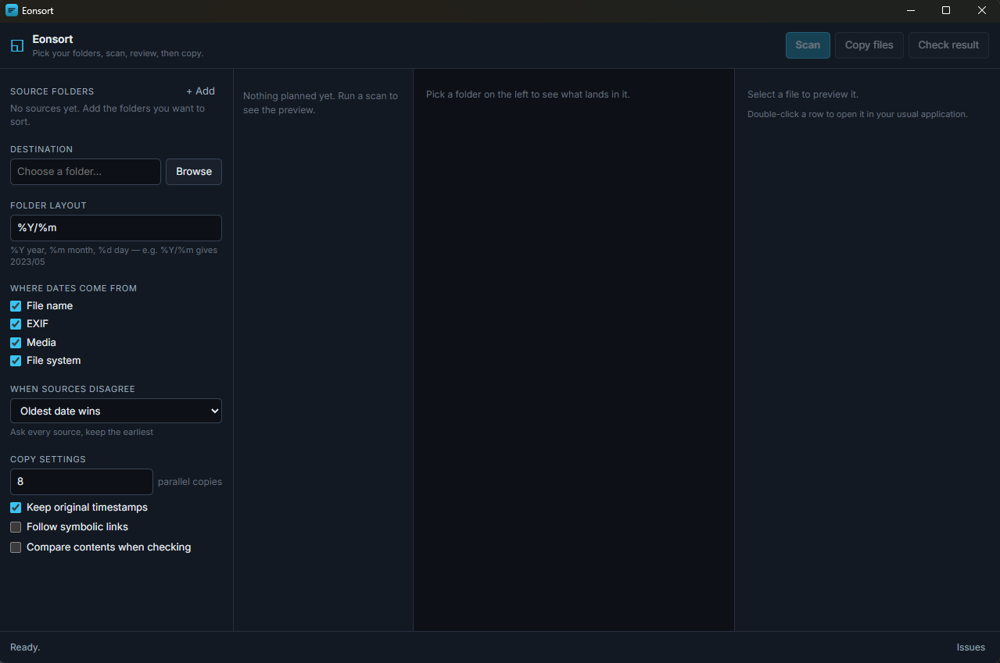

# eonsort

[](https://github.com/it-atelier-gn/eonsort/actions)
[](LICENSE)

Sorts photos and videos into date-based folders by the date they were taken, not the date a backup
tool last touched them.

Point it at your folders, press **Scan**, and review the whole resulting tree before anything is
copied. Then press **Copy files**. Your sources are only read. The single exception is **Remove
extra identical copies**, which sends duplicates to the recycle bin when you press it.

Windows, Linux and macOS, as a desktop app and as the `eonsort` command line tool.



**[What it does, in full →](https://it-atelier-gn.github.io/eonsort/)**

---

## Install

Download an installer from the [releases page](https://github.com/it-atelier-gn/eonsort/releases).

Some extras are downloaded once, from the desktop app's setup panel, when you turn them on:

| Extra                       | Download |
| --------------------------- | -------- |
| Place names, for `{city}` … | 14 MB    |
| Tagging                     | 780 MB   |
| Quality rating              | 335 MB   |

Face recognition comes with the program.

---

## Command line

```sh
eonsort sort --source "D:\Photos" "D:\Downloads" --destination "E:\Sorted"
```

Or plan first, review, then copy:

```sh
eonsort scan --source "D:\Photos" --plan photos.jsonl
eonsort show --plan photos.jsonl --suspect
eonsort copy --plan photos.jsonl --destination "E:\Sorted"
eonsort verify --plan photos.jsonl --hash
```

Stop a copy with Ctrl-C and run the same command again to continue.

| Command   | What it does                                                         |
| --------- | -------------------------------------------------------------------- |
| `sort`    | Scan and copy in one go                                              |
| `scan`    | Work out where each file goes and write it to a plan                 |
| `show`    | List the entries of a plan                                           |
| `offsets` | Find runs of files whose camera clock was off by the same amount     |
| `copy`    | Copy the files in a plan                                             |
| `verify`  | Check the copies against the plan                                    |
| `watch`   | Keep sorting whatever arrives in the sources, until stopped          |
| `presets` | List the ready-made layouts                                          |
| `places`  | Download the place names, once, into a folder of your choice         |

| Flag                          | Meaning                                                                                   |
| ----------------------------- | ----------------------------------------------------------------------------------------- |
| `--source`, `--destination`   | Folders to read from, and where the sorted tree goes                                      |
| `--plan`                      | The plan file to write or read                                                            |
| `--pattern "%Y/%m"`           | Folder layout (see [Patterns](#patterns))                                                 |
| `--name-pattern`              | File name layout. Left out, files keep their names                                        |
| `--preset day`                | Use a ready-made layout                                                                   |
| `--gazetteer <folder>`        | The folder `eonsort places` downloaded into                                               |
| `--provider filename exif`    | Only these date sources, in this order                                                    |
| `--strategy oldest`           | `smart` (default) weighs the sources, `oldest` takes the earliest, `priority` the first   |
| `--weight exif=45`            | How much a source counts under `smart`, 0 to 100                                          |
| `--suspect`                   | On `show`, only entries whose date looks wrong                                            |
| `--json`                      | On `show` and `offsets`, print JSON                                                       |
| `--auto-rotate`               | Turn sideways pictures upright in the copy                                                |
| `--split-companions`          | Date each file on its own instead of with its RAW, live photo or sidecar group            |
| `--follow-symlinks`           | Follow symbolic links in the sources                                                      |
| `--stamp-date`                | Write the chosen date into JPEG copies                                                    |
| `--sidecars`                  | Leave an XMP sidecar beside each copy                                                     |
| `--no-preserve-times`         | On `copy`, don't carry the source timestamps over                                         |
| `--jobs 8`                    | Files to copy in parallel                                                                 |
| `--hash`                      | On `verify`, compare contents, not only sizes                                             |
| `--interval 60` `--settle 15` | On `watch`, seconds between looks, and how long a file must stop growing before it's taken |

---

## Patterns

`--pattern` shapes the folders and `--name-pattern` the file names. Both take
[strftime](https://docs.rs/chrono/latest/chrono/format/strftime/) fields and `{token}` fields.
Separate tokens with `|` to use the first one a file has, and end with a quoted word as a fallback.

```sh
eonsort sort --source "D:\Photos" --destination "E:\Sorted" \
  --pattern '%Y/%Y-%m-%d/{city|country|"unknown place"}' \
  --name-pattern '%Y%m%d-%H%M%S-{original_stem}'
```

| Token                                            | What it is                                        |
| ------------------------------------------------ | ------------------------------------------------- |
| `{city}` `{region}` `{country}` `{country_code}` | Where the picture was taken, from its GPS reading |
| `{camera_make}` `{camera_model}`                 | The camera that took it                           |
| `{original_name}` `{original_stem}` `{ext}`      | The file's name, without extension, its extension |
| `{subject}`                                      | The named person in the picture (desktop app)     |

Places are looked up on your computer; nothing is sent anywhere.

Presets: `plain`, `day`, `place`, `immich`, `photoprism`, `elodie`.

---

## Build from source

Needs [Rust](https://rustup.rs/) 1.90+, [Node.js](https://nodejs.org/) 22.17+, a C compiler,
[CMake](https://cmake.org/) and [NASM](https://nasm.us/).

- Windows: Visual Studio Build Tools with the C++ workload
- Linux: `libwebkit2gtk-4.1-dev libappindicator3-dev librsvg2-dev patchelf`

```sh
git clone https://github.com/it-atelier-gn/eonsort.git
cd eonsort
npm install
npx tauri build --features tagging,quality,faces
cargo build --release -p eonsort-cli
```

Before opening a pull request, run `npm run gate`; it runs the same checks as CI. For substantial
changes, open an issue first.

---

## License

MIT, see [LICENSE](LICENSE).

Place names: [GeoNames](https://www.geonames.org/), CC BY 4.0.
Face detection: [YuNet](https://github.com/opencv/opencv_zoo/tree/main/models/face_detection_yunet), MIT.
Face recognition: [SFace](https://github.com/opencv/opencv_zoo/tree/main/models/face_recognition_sface), Apache 2.0, converted from ONNX to safetensors.
Tagging: [SigLIP](https://huggingface.co/google/siglip-base-patch16-224), Apache 2.0.
Quality rating: [aesthetics-predictor-v1](https://huggingface.co/shunk031/aesthetics-predictor-v1-vit-base-patch32), MIT.
